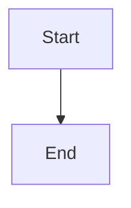

# AGENTS.md — Markdown document conventions for devdocs

This repository uses **devdocs** to render a directory of documentation files as a website. Follow these conventions when creating or editing Markdown (`.md`) documents so they render, navigate, and search correctly.

## Scope

- These rules apply to **Markdown documentation pages** published by devdocs (typically under the configured `docs_dir`, default: `docs/`).
- Keep existing documents working: front matter is optional and invalid/non-mapping front-matter headers are ignored by the renderer.
- The generated site home (`/`) is an automatic index of published docs. A file named `index.md` is a normal page served at `/index` (it does not replace the generated home page).

## File and folder naming

- **Preferred:** use lowercase `kebab-case` for file and folder names.
  - Good: `getting-started/install-guide.md`, `guides/native-backend-setup.md`
  - Avoid when possible: spaces, mixed separators, unclear abbreviations
- Devdocs prettifies names for display in navigation, breadcrumbs, and index cards (e.g. `getting-started` → **Getting Started**, `APIReference` → **API Reference**), but consistent source names make docs easier to maintain and link.
- Use `.md` (or `.markdown`) for Markdown pages.
- Organize related pages into folders; folder structure becomes sidebar sections.
- Do not rely on unpublished files: anything excluded by config `ignore` patterns or not included by `file_types` will not be served/linked.

## Front matter (optional custom header)

Markdown pages may start with a YAML front-matter block delimited by `---` lines. Place it at the very top of the file (before the page body).

```md
---
title: Getting Started
description: Install and run the project locally.
tags: [setup, intro]
order: 10
sidebar_label: Getting Started
draft: false
hidden: false
---

# Getting Started

Page content starts here.
```

### Supported fields

| Field | Type | Purpose / behavior |
| --- | --- | --- |
| `title` | string | Canonical page title. Used for display/index metadata and as nav label fallback when `sidebar_label` is not set. |
| `description` (or `summary`, `excerpt`) | string | Short summary shown on index cards and used in search/ranking and page metadata. |
| `tags` (or `labels`) | list of strings, or comma-separated string | Topic tags shown on index cards/page metadata and used in search/ranking. |
| `order` (or `weight`) | number | Sort order within the same navigation/index section (lower values appear earlier). Pages without `order` sort after ordered pages, then alphabetically by label. |
| `sidebar_label` (or `nav_label`, `label`) | string | Label shown in the sidebar navigation (overrides `title` for nav). |
| `draft` | boolean | If `true`, the page is excluded from navigation, index, search, and docs chat/retrieval. |
| `hidden` | boolean | Same effect as `draft` for visibility in navigation/index/search/chat. |

### Front matter rules

- Use valid YAML mapping syntax (`key: value`).
- Start and end the block with `---` on their own lines (closing `...` is also accepted).
- Keep front matter at the beginning of the file; content before it is not treated as metadata.
- Omit unknown fields only if needed; prefer the supported fields above. (Unknown keys are not used by devdocs.)
- If the front matter is malformed or not a mapping, devdocs ignores it and renders the file normally—so validate YAML formatting when adding metadata.

## Document body conventions

- **Headings:** prefer exactly one top-level heading (`# Page Title`) per page, near the top of the body.
  - If you set `title` in front matter and the rendered body does not begin with an `h1`, devdocs may display the front-matter title/description/tags as a header block.
  - Use a clear heading hierarchy (`##`, `###`, ...) and do not skip levels unnecessarily.
- **Introduction:** start with a short introductory paragraph explaining purpose/context; this also improves search snippets and docs-chat grounding.
- **Structure:** use sections, lists, and tables for scannability; keep paragraphs focused.
- **Tone/style:** be clear, specific, and task-oriented. Prefer concrete steps, examples, and expected outcomes.

## Links, assets, and references

- **Internal doc links:** prefer relative links between Markdown files.
  - Both `./setup.md` / `../guide.md` and extension-less doc routes may work in rendered output; relative links are safest for source portability. Devdocs rewrites relative `.md` links in rendered pages to match extension-less routes.
- **Anchors:** use standard Markdown heading anchors/fragment links when needed (e.g. `./setup.md#installation`).
- **Images/assets:** reference assets with relative paths (e.g. ``).
  - Ensure required file types (e.g. `images`) are enabled in `devdocs.yml`/CLI so assets are published and served.
- **External links:** use full URLs (`https://...`).
- Use descriptive link text (avoid bare "here" when possible).

## Code, data, and diagrams

- Use fenced code blocks with a language identifier for syntax highlighting:
  - Examples: ```bash, ```python, ```json, ```yaml, ```toml
- Keep examples minimal but complete enough to be useful; prefer copy-pasteable commands/snippets.
- **Mermaid diagrams:** use fenced `mermaid` blocks; devdocs renders them with an interactive viewer.



- For long outputs or large data, show representative excerpts and explain omissions.

## Navigation, ordering, and visibility

- Use `order` to control page sequence within a folder/section when alphabetical/prettified ordering is not sufficient.
- Use `sidebar_label` when the desired nav label should differ from the page `title` or filename.
- Use `draft: true` or `hidden: true` for work-in-progress pages that should not appear in navigation, index, search, or docs-only chat.
- Keep titles, descriptions, and tags accurate—search and the docs assistant rely on published Markdown content and metadata.

## Recommended page template

```md
---
title: <Page title>
description: <One-sentence summary of what this page covers>
tags: [<tag-1>, <tag-2>]
order: <number>
---

# <Page title>

<Short introduction: what this is and when to use it.>

## Prerequisites

- ...

## Steps

1. ...
2. ...

## Examples

```bash
# example command
```

## Related

- [Related page](./related-page.md)
```

## Checklist before finishing edits

- [ ] File is in the correct docs location/folder with a clear `kebab-case` name
- [ ] Front matter (if present) is valid YAML at the top of the file
- [ ] `title`/`description`/`tags`/`order` are set when useful for navigation and discovery
- [ ] Page has one clear `#` heading and logical section structure
- [ ] Relative links and asset paths resolve correctly
- [ ] Code/mermaid fences specify the correct language where applicable
- [ ] Draft/incomplete pages are marked `draft: true` or `hidden: true` if they should not be published in nav/search/chat
- [ ] Content is factual and consistent with the current codebase/configuration
